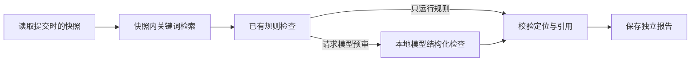

# LangGraph 草稿预审第一版

这是可在 macOS / Linux 运行的本地开发功能，默认关闭。仅支持大创创新训练项目；没有部署为云端生产任务，也没有接入生产计费。现有聊天、模拟评审与 Word 导出继续使用原来的入口。

## 快速运行

在仓库根目录安装可选依赖：

```sh
uv sync --extra review --extra server
```

API 与 worker 必须使用同一个绝对数据目录。以下是两个终端中的命令；端口 8765 仅绑定本机回环地址。

```sh
LOCAL_REVIEW_ENABLED=true PROPOSAL_AGENT_DATA_DIR="$PWD/.agent-data" \
  uv run --no-sync uvicorn server.app:app --host 127.0.0.1 --port 8765
```

```sh
uv run --no-sync python server/review_worker.py --local-data "$PWD/.agent-data"
```

打开 `http://127.0.0.1:8765`，在创新训练项目中保存正文。在“合规质检与 Word 交付”中选择“检查这版草稿”。默认只运行规则；勾选“同时检查论证与事实依据”后，会调用本机 Ollama。默认模型 `qwen2.5:7b`，可用 `OLLAMA_MODEL` 指定。上传材料需先核对并明确确认，且完成索引，才能进入模型证据。不会自动下载模型。

独立合成演示不读取现有项目数据：

```sh
uv run --no-sync python scripts/demo_review_graph.py --output outputs/qa/langgraph-review/rules.json
uv run --no-sync python scripts/demo_review_graph.py --model --output outputs/qa/langgraph-review/model.json
```

## 实际工作流



`review_runs.py` 在一次 SQLite 事务中捕获项目、材料与可搜索片段，计算完整输入指纹。报告绑定这个指纹，草稿后续修改不影响已提交任务。相同项目、请求键与输入返回同一个任务；请求键对应不同输入时返回 409。读取报告需要同时匹配项目与运行 ID。

`review_graph.py` 使用 `StateGraph`、条件边与 `SqliteSaver`。已有 `ProposalTools.validate_project` 与 `ProjectRetriever` 被限制在只读快照适配器上；它没有任何正文更新、事实确认或导出工具。结构和数字检查属于基础规则；该版没有增加通用预算明细表解析器，不能声称已检查所有表格算术。

证据只从提交时明确由用户确认、仍与当前识别文字匹配的片段召回。默认关键词检索，不调用嵌入服务。模型只收到正文、目录、学校名称和召回片段；不会收到未确认材料、磁盘路径、账号令牌或其他项目内容。

模型首版优先报告主要问题，最多 6 条，并限制输出 token 数；不是穷尽式评审。运行可能因本机模型负载而超时，此时任务保留“调用结果待核对”，不会自动重发。

`verify` 检查章节 ID、草稿逐字引用、来源 ID 和来源逐字引用。无法定位的意见被过滤，错误来源被移除并产生提示。来源匹配不等于语义支持或适用范围验证：所有模型意见仍标为待人工核对，不能当作学校正式要求。资料不足会明确提示。模型 JSON 不合法或输入超过 26,000 字符时，报告注明 AI 检查未完成，只保留规则结果。

## 恢复与数据生命周期

`server/review_worker.py` 是单进程独立 worker，不依赖浏览器连接。OS 文件锁限制同一数据目录只有一个执行器；进程退出后锁自动释放，新 worker 从磁盘检查点继续。每个节点记录名称和耗时。当前运行保存模型输出 token 数、输入 token 数和调用耗时（模型服务返回时）；这些不是人民币计费记录。

模型调用先持久化 `started` 标记，成功输出再持久化，最后写图检查点。恢复时可复用已记录的响应；只有 `started` 而没有响应时，转为 `needs_review`，不会自动重发。普通已捕获错误终止任务，用户可显式“重新检查当前草稿”。不同代码版本不会自动重放旧图。

检查点、待写状态、输入快照、模型结果与事件均属于项目。使用 SqliteSaver 3.1.3 的表结构并增加外键级联约束；删除项目会清除这些数据，所有检查点连接启用外键。依赖升级必须复验表结构和删除行为。工作进程关闭环境中可能开启的外部 LangSmith tracing；本版本没有接入外部可观测平台。

## HTTP 接口

| 方法与路径 | 用途 |
| --- | --- |
| `GET /api/reviews/capabilities` | 查询当前入口是否可用 |
| `GET /api/projects/{project_id}/reviews` | 当前输入指纹与最近 20 次报告 |
| `POST /api/projects/{project_id}/reviews` | 使用指纹、请求键和 `rules` / `model` 模式提交；返回 202 |
| `GET /api/projects/{project_id}/reviews/{run_id}` | 查询状态、完整报告和节点耗时 |

POST 示例：

```json
{
  "fingerprint": "从列表接口读取的64位输入指纹",
  "idempotency_key": "一次用户操作的稳定请求键",
  "mode": "rules"
}
```

请求键只用于提交去重，不是登录凭据。页面在 sessionStorage 保留未确认提交的键和指纹；刷新时查询已有运行，不会自动创建新任务。网页用 textContent 渲染意见和引文。

## 验证与下一阶段

运行 `python -m pytest tests/test_review_graph.py tests/test_review_api.py tests/test_review_transport.py -q` 和 `node --test tests/js/draft_review.test.js`。检查覆盖进程直接退出后恢复、模型结果不明时不重发、已记录响应复用、并发 worker 排斥、旧版草稿绑定、项目隔离、删除级联、非法引文过滤及页面请求去重。这些是工程行为验证，不是模型效果准确率。

云端阶段需单独实现受账号和项目约束的持久化任务队列、数据库检查点、独立云端 worker、租约、授权读取及现有计费代理，再做迁移和真实故障验收。不能把这里的 SQLite 文件放进 Vercel `/tmp` 后声称云端可恢复。当前入口在 Supabase 云模式和 Vercel 环境中始终关闭。

后续效果评测应使用固定、授权的案例，分别记录检索命中、意见误报/漏检、引文支持程度、任务完成率、耗时与费用。人工补充材料的 `interrupt()` / `Command(resume=...)` 工作流及多 Agent 协作尚未实现。
